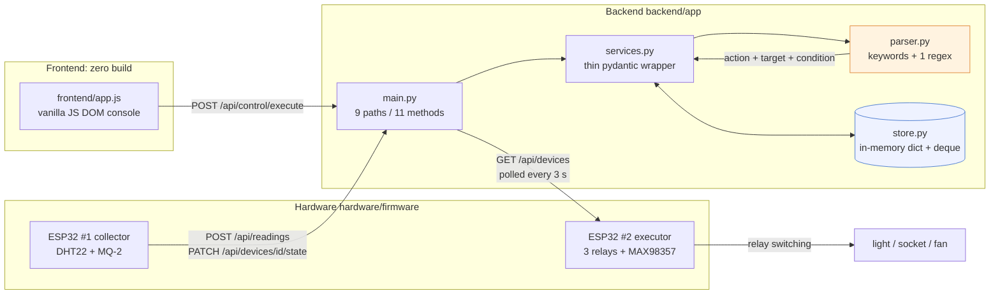

# Smart Home Voice Console · Rule-based Parser + FastAPI + Dual ESP32

**English** | [简体中文](README.md)


> Parses Chinese commands like「打开客厅主灯」(*turn on the living-room light*) into
> structured `action + target` commands and applies them to in-memory device state.
> FastAPI backend (11 endpoints), a zero-build vanilla-JS console, and two ESP32 boards
> (one samples temperature/humidity/gas, one drives three relays).
> **Command parsing is keyword + regex based — no large language model is called.**

---

## Read this first: there is no LLM here

The original project is titled "based on a large language model", but **no model call exists
in the code**. This is stated up front because it determines whether the repo is trustworthy:

- `app/parser.py:parse_command_text()` is **4 target keyword groups (7 words), 3 verb keyword
  groups (5 words) and 1 regex**. No HTTP calls, no SDK, no token billing.
- A full scan for `sk-` / `api_key` / `password` / `secret` / `token` / `dashscope` / `qwen` /
  `openai` returns **no real credentials**. The only key-shaped strings are firmware
  placeholders (`"YOUR_WIFI_SSID"` / `"YOUR_WIFI_PASSWORD"`).
- The backend reads **no environment variables**, which is why there is no `.env.example` —
  there is literally nothing to configure.

The route is still named `/api/llm/parse-command` because that is the original naming; the
front-end card is still titled "大模型指令解析" for the same reason. **The naming does not match
the implementation — that is inherited technical debt**, listed as limitation #1 below.
Real LLM parsing is on the Roadmap, not in this version.

---

## Why it is built this way

The first version is rule-based not because rules are better, but because **rule-based parsing
can be fully verified in this project**:

| Aspect | Rule-based (current) | LLM parsing (Roadmap) |
| --- | --- | --- |
| External dependency | none, stdlib only | model API or local weights |
| Latency | microseconds | hundreds of ms to seconds |
| Offline | fully offline | needs network or local inference |
| Testability | I/O can be enumerated and asserted (84 cases) | unstable output, needs an eval set |
| Generalisation | 7 target words + 5 verb words | understands「有点热」/「灯弄暗点」 |
| Failure mode | degrades to `unknown` — safe, not clever | may hallucinate actions never asked for |

`unknown` is an explicit, tested capability boundary. When an LLM is wired in, these 84 cases
become the regression baseline for "is the model actually better than the rules?".

---

## Architecture



`parser.py` is the only module with business judgement and it imports nothing outside the
standard library. `services.py` only converts between dicts and pydantic models and touches
the store. That split is what lets the core logic be tested on a machine with **no fastapi
and no pydantic** installed (the `test-stdlib` CI job installs exactly zero packages).

---

## Core modules

| Module | File | Responsibility | Key implementation |
| --- | --- | --- | --- |
| Rule engine | `backend/app/parser.py` | parsing, device matching, alert rules | `TARGET_KEYWORDS` (4 groups / 7 words), 3 verb groups (5 words), `TEMP_CONDITION_PATTERN`, strict-greater thresholds |
| Service layer | `backend/app/services.py` | dict ↔ pydantic, uuid, store access | `parse_command` / `execute_command` / `evaluate_alerts` / `_find_devices_by_target`, all delegated to `parser` |
| Models | `backend/app/models.py` | request/response contracts | `DeviceType` (light/socket/sensor/other), `Device`, `SensorReading`, `Alert`, `ParsedCommand`; pydantic v2 |
| Store | `backend/app/store.py` | single-process state | `dict` for devices, `deque(maxlen=2000)` readings, `deque(maxlen=500)` alerts |
| HTTP API | `backend/app/main.py` | 9 paths / 11 methods | open CORS, `/api/demo/seed`, `HTTPException(404)` on missing device |
| Frontend | `frontend/app.js` | demo console | 288 lines of vanilla JS; API base kept in `localStorage` |
| Collector firmware | `hardware/firmware/esp32_smart_home/` | ESP32 #1 | DHT22 (GPIO4), MQ-2 (GPIO34), reports every 10 s |
| Executor firmware | `hardware/firmware/esp32_control_node/` | ESP32 #2 | 3 low-level-trigger relays (GPIO16/17/18), polls state every 3 s |
| Hardware docs | `hardware/` | wiring & BOM | pin tables, 4 SVG diagrams, KiCad skeleton, 16-line BOM |

---

## How parsing actually works

1. **Normalise**: strip, collapse whitespace, lowercase ASCII.
2. **Targets × verbs**: for each matched target (fixed table order) check the three verb groups
   (`打开`/`开启` → `turn_on`, `关闭` → `turn_off`, `调亮`/`亮一点` → `set_brightness`).
   **One sentence can emit several commands.**
3. **Conditional**: regex `温度(超过|高于|大于)(\d+(?:\.\d+)?)` plus a turn-on verb appends a
   `conditional_turn_on` command. The threshold is recorded in the `condition` string
   (`"temperature>30.0"`) — it is **annotated, never evaluated**.

Real parse results (`POST /api/llm/parse-command`, matching `tests/test_command_parser.py`):

| Input | Output |
| --- | --- |
| `打开客厅主灯` | `turn_on / light` |
| `关闭卧室插座` | `turn_off / socket` |
| `把客厅主灯调亮一点` | `set_brightness / light` (value is always the string `"up"`) |
| `如果温度超过30度就打开风扇` | `turn_on / fan` + `conditional_turn_on / fan`, `condition=temperature>30.0` |
| `打开风扇和空调` | `turn_on / fan` + `turn_on / ac` — both map to `other`, same device updated twice |
| `把卧室空调调到 26 度` | **`unknown`** |
| `客厅温度多少` | **`unknown`** |
| `开灯` | **`unknown`** (`开` is not `打开`/`开启`) |

Device matching is one table and **ignores `location` and `name`**:

```python
TARGET_DEVICE_TYPES = {
    "light": {"light"}, "socket": {"socket"},
    "fan": {"other"}, "ac": {"other"},   # known flaw: both share `other`
}
```

So `打开客厅主灯` switches on **every** `type=light` device.

---

## Quick start

```bash
git clone https://github.com/DOUFUQAQ/smart-home-agent.git
cd smart-home-agent

python -m venv .venv
.venv\Scripts\Activate.ps1        # Windows PowerShell
# source .venv/bin/activate       # macOS / Linux

pip install -r requirements.txt
```

Start the backend (from `backend/`, because the package is named `app`):

```bash
cd backend
uvicorn app.main:app --reload --port 8000
```

Seed demo data and parse a command:

```bash
curl http://127.0.0.1:8000/health
# {"status":"ok"}

curl -X POST http://127.0.0.1:8000/api/demo/seed

curl -X POST http://127.0.0.1:8000/api/llm/parse-command \
     -H "Content-Type: application/json" \
     -d '{"text":"如果温度超过30度就打开风扇"}'
```

```json
{
  "normalized_text": "如果温度超过30度就打开风扇",
  "commands": [
    {"action": "turn_on", "target": "fan", "value": null, "condition": null},
    {"action": "conditional_turn_on", "target": "fan", "value": null, "condition": "temperature>30.0"}
  ]
}
```

> On Windows `cmd`, piping UTF-8 Chinese inside `-d` often corrupts the body and you will get
> `unknown` back. Use PowerShell `Invoke-RestMethod`, or send a UTF-8 `.json` file with
> `--data-binary @body.json`.

Front-end (another terminal, from the repo root):

```bash
python -m http.server 5500 --directory frontend
# open http://127.0.0.1:5500, set the backend address to http://127.0.0.1:8000
```

Firmware: open either `.ino` in the Arduino IDE, board `ESP32 Dev Module`, edit
`WIFI_SSID` / `WIFI_PASS` / `API_BASE` / `DEVICE_ID`, libraries `DHT sensor library` and
`ArduinoJson`. Pin tables: [hardware/PIN_CONNECTION_GUIDE.md](hardware/PIN_CONNECTION_GUIDE.md).

---

## Project layout

```
smart-home-agent/
├── README.md / README.en.md
├── LICENSE                          # MIT
├── requirements.txt                 # fastapi / uvicorn / pydantic
├── requirements-dev.txt             # pytest / httpx / ruff
├── pytest.ini                       # testpaths = tests
├── conftest.py                      # puts backend/ on sys.path
├── .github/workflows/ci.yml         # dependency-free unittest + full pytest + ruff
├── backend/
│   ├── pytest.ini                   # original config: only backend/tests
│   ├── app/
│   │   ├── main.py                  # 9 paths / 11 methods
│   │   ├── models.py                # pydantic v2 models
│   │   ├── parser.py                # pure rule engine, no third-party deps
│   │   ├── services.py              # thin pydantic wrapper
│   │   └── store.py                 # in-memory dict + deque
│   └── tests/test_api.py            # 6 FastAPI TestClient cases
├── frontend/                        # zero-build vanilla JS
├── hardware/
│   ├── PIN_CONNECTION_GUIDE.md
│   ├── firmware/esp32_smart_home/   # ESP32 #1 collector
│   ├── firmware/esp32_control_node/ # ESP32 #2 executor
│   ├── diagrams/                    # 4 SVG wiring diagrams
│   └── cad/kicad/                   # KiCad skeleton + BOM.csv
└── tests/                           # 84 stdlib unittest cases
    ├── test_command_parser.py       # 29: parsing + capability boundaries
    ├── test_device_matching.py      # 22: target matching + command execution
    ├── test_alert_rules.py          # 16: threshold alerts
    └── test_services_layer.py       # 17: pydantic layer, auto-skipped without it
```

---

## Tests

```bash
python -m unittest discover -s tests -t .   # 84 cases, zero third-party deps
python -m pytest -q                         # same, if pytest is installed
python -m pytest backend/tests -q           # 6 FastAPI API cases (needs fastapi+httpx)
```

Measured locally:

| Interpreter | Environment | Result |
| --- | --- | --- |
| Python 3.12.14 | stdlib only (no fastapi / pydantic / pytest) | `Ran 84 tests` → `OK (skipped=17)` |
| Python 3.13.5 | pydantic 2.13.4 / fastapi 0.136.1 | `Ran 84 tests` → `OK` (all 84) |
| Python 3.13.5 | same | `pytest backend/tests` → `6 passed` |

What is covered:

- **Parsing (29)** — four targets, three verb groups, conditional commands, decimal thresholds,
  multiple intents per sentence, normalisation, and the **capability boundaries**:
  `把卧室空调调到 26 度`, `客厅温度多少`, `开灯` must all degrade to `unknown`.
- **Matching & execution (22)** — the `fan`/`ac` → `other` collision, sensors not addressable,
  `unknown` touching nothing, the same device updated twice, `打开灯然后关闭灯` ending as `off`.
- **Alerts (16)** — strict-greater thresholds, alert ordering, demo readings yielding exactly
  3 alerts.
- **pydantic layer (17, skippable)** — `services.parse_command()` matches
  `parser.parse_command_text()` case by case, seed counts, `KeyError` on missing devices.

Two further cases are **architecture guards**: an AST check that `parser.py` imports only
`__future__` / `re` / `typing`, and a source scan forbidding `http://`, `requests.` and `sk-`.
Anyone adding a network call or a hard-coded key to the parsing layer turns CI red.

---

## Hardware scope

**Included**: both ESP32 firmware sources (325 lines of `.ino`), the two-node pin guide,
4 SVG wiring diagrams (plain-text vectors), KiCad project files, and the 16-line BOM.

**Not included** (absent upstream, binary, or machine-local):

- Schematic symbols and PCB routing: `lib_symbols` in `smart_home_esp32.kicad_sch` is empty and
  the `.kicad_pcb` contains only an 80×50 board outline — **no footprints, no traces**. The PCB
  was never finished.
- The whole `pcb/家居/` directory: a 79-byte `.kicad_pcb` and 230-byte `.kicad_sch` that are
  unused empty shells duplicating `hardware/cad/kicad/`.
- KiCad auto-backup zips, local editor state (`.kicad_prl`), `.history/` (KiCad's own Git
  history), MCP tool logs, and every thesis/report document (`*.docx`, proposals, papers).

---

## Known limitations

Read out of the code, ordered by severity:

1. **No LLM.** Parsing is keywords + regex; `/api/llm/parse-command` and the front-end title are
   inherited naming. This is the single most important thing to state about the repo.
2. **No voice pipeline.** The firmware defines INMP441 I2S pins (GPIO26/27/33) but
   `esp32_smart_home.ino` only samples DHT22 / MQ-2 — **there is no I2S read or audio upload
   code at all**. The current "voice input" is a text box.
3. **Poor colloquial coverage.** Only 7 target words and 5 verb words; `开灯`,
   `把空调调到26度`, `客厅温度多少` all collapse to `unknown` (asserted in tests).
4. **No query intent.** The system can only issue actions; it cannot answer "how warm is it".
5. **No location/device disambiguation.** Matching is by `type` only, so `打开客厅灯` hits every
   light.
6. **`fan` / `ac` collide.** Both map to `other`, so `打开空调` switches the fan on
   (verified end to end).
7. **Brightness is a string.** `set_brightness` writes `state["brightness"] = "up"`; no
   percentage, no dimmer capability check.
8. **Gas threshold unit mismatch.** The firmware reports the raw `analogRead()` value (0–4095)
   as `gas_ppm` while the backend compares against `300.0` (a ppm-scale threshold) — with real
   MQ-2 hardware nearly every reading would raise a `critical` alert.
9. **Alerts have no dedup and no hysteresis.** Every over-threshold reading creates a new
   `Alert`; the `deque(maxlen=500)` silently drops old ones.
10. **All state is in memory.** Restart wipes it; `uvicorn --workers N` keeps N divergent copies.
    The original `backend/smart_home.db` is a leftover from an earlier SQLite implementation
    (its `brightness` / `is_online` / `severity` columns do not match the current models) and is
    not part of this repo.
11. **No auth, fully open CORS.** `allow_origins=["*"]` together with
    `allow_credentials=True` (an invalid combination browsers reject); anyone on the LAN can
    control the devices.
12. **Conditional commands are annotated, not evaluated.** `conditional_turn_on` stores
    `temperature>30.0` in `state["condition"]` but no rule engine evaluates it — the fan turns
    on immediately.
13. **PCB / schematic unfinished** (see the hardware section).
14. **Front end has no tests and no build.** 288 lines of hand-written DOM code; errors surface
    only in the message bar.
15. **`/api/demo/seed` returns demo commands without executing them** — you must paste them into
    the parse/execute boxes.

## Roadmap

- [ ] Real LLM parsing (OpenAI-compatible endpoint / local model), keeping the rule engine as a
      fallback and evaluation baseline
- [ ] A labelled Chinese smart-home command eval set to quantify rules vs LLM accuracy
- [ ] Voice pipeline: ESP32 I2S capture → upload → ASR → parse → TTS (MAX98357 hardware exists)
- [ ] Add `fan` / `ac` device types and disambiguate by `location` + `name`
- [ ] Query intents and state read-back
- [ ] MQ-2 calibration (ADC → ppm) or a configurable relative threshold
- [ ] Alert dedup / hysteresis / cooldown window
- [ ] Persistence (SQLite) and multi-process consistency
- [ ] Auth (API key / JWT) and a CORS allow-list
- [ ] Finish KiCad symbols and PCB routing, export Gerbers
- [ ] Lightweight front-end tests

## License

[MIT](LICENSE) © 2026 DOUFUQAQ
