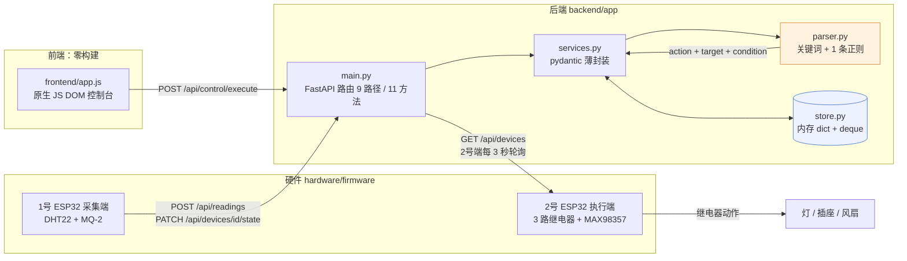

# 智能家居语音交互 Demo · 规则解析 + FastAPI + 双 ESP32

[English](README.en.md) | **简体中文**


> 把「打开客厅主灯」这类中文指令解析成 `action + target` 的结构化命令，落到内存里的
> 设备状态上；后端 FastAPI 提供 11 个接口，前端是一个零构建的原生 JS 控制台，
> 硬件侧是两块 ESP32 —— 一块采集温湿度与可燃气体，一块驱动 3 路继电器。
> **当前版本的指令解析是关键词 + 正则，没有调用任何大模型。**

---

## 先说清楚：这里没有大模型

这个仓库的原名是「基于语言大模型的…」，但**代码里没有模型调用**。这一点必须写在最前面，
因为它决定了可信度：

- 解析函数 `app/parser.py:parse_command_text()` 的全部实现是 **4 组目标关键词（共 7 个词）
  + 3 组动词关键词（共 5 个词）+ 1 条正则**，没有 HTTP 请求、没有 SDK、没有 token 计费；
- 全仓库扫过 `sk-` / `api_key` / `password` / `secret` / `token` / `dashscope` / `qwen` / `openai`，
  **没有命中任何真实凭据**。唯一像密钥的东西是固件里的 `WIFI_SSID` / `WIFI_PASS` 占位符
  （`"YOUR_WIFI_SSID"` / `"YOUR_WIFI_PASSWORD"`），也不是真实值；
- 后端**不读任何环境变量**，所以这个仓库没有 `.env.example` —— 不是为了省事，是真的没有配置项。

那为什么路由还叫 `/api/llm/parse-command`？因为原始工程的命名就是这样，本仓库没有改它
（前端页面标题「大模型指令解析」同理）。**命名和实现不一致，是原始工程遗留的技术债**，
已列在下面的「已知局限」第一条。LLM 解析在 Roadmap 里，不在这个版本里。

---

## 为什么这么做

第一版先做规则解析，不是因为规则解析更好，而是因为它**在这个项目里可以被完全验证**。
一个演示系统最怕的是「看起来能跑但说不清哪里会坏」：

| 维度 | 规则解析（当前实现） | LLM 解析（Roadmap） |
| --- | --- | --- |
| 外部依赖 | 0，纯标准库 | 模型 API 或本地权重 |
| 单次延迟 | 微秒级 | 数百 ms ~ 数秒 |
| 离线可用 | 完全离线 | 需网络，或本地推理硬件 |
| 可测试性 | 输入输出可穷举断言（84 个用例） | 输出不稳定，需要评测集而非单测 |
| 泛化能力 | 只认 7 个目标词 + 5 个动词 | 能理解「有点热」「灯弄暗点」 |
| 失败模式 | 退化成 `unknown`，安全但不聪明 | 可能幻觉出用户没说过的动作 |

结论写在代码里也写在测试里：**当前实现的能力边界是可测的**，`unknown` 就是明确的能力边界。
真正把 LLM 接进来时，这 84 个用例可以直接变成回归基线，用来衡量「模型到底比规则强多少」。

---

## 架构



**关键点**：`parser.py` 是唯一「有业务判断」的地方，它不 import 任何第三方包；
`services.py` 只做 dict ↔ pydantic 的转换和内存读写。这个分层不是洁癖 ——
它让核心逻辑可以在**没装 fastapi / pydantic 的机器上**跑测试（CI 里专门有一个
`test-stdlib` job 就是一个包都不装）。

---

## 核心模块

| 模块 | 文件 | 职责 | 关键实现 |
| --- | --- | --- | --- |
| 规则引擎 | `backend/app/parser.py` | 指令解析、设备匹配、告警判定 | `TARGET_KEYWORDS`（4 组 / 7 个目标词）、3 组动词词表（共 5 个词）、`TEMP_CONDITION_PATTERN` 1 条正则、严格大于阈值 |
| 业务封装 | `backend/app/services.py` | dict ↔ pydantic、uuid、内存读写 | `parse_command()` / `execute_command()` / `evaluate_alerts()` / `_find_devices_by_target()`，全部委托给 `parser` |
| 数据模型 | `backend/app/models.py` | 请求/响应契约 | `DeviceType`(light/socket/sensor/other)、`Device`、`SensorReading`、`Alert`、`ParsedCommand`；pydantic v2 `model_dump` |
| 内存存储 | `backend/app/store.py` | 单进程状态 | `dict` 存设备、`deque(maxlen=2000)` 存读数、`deque(maxlen=500)` 存告警 |
| HTTP 接口 | `backend/app/main.py` | 9 条路径 / 11 个方法 | CORS 全开、`/api/demo/seed` 一键灌演示数据、`HTTPException(404)` 处理缺失设备 |
| 前端 | `frontend/app.js` | 演示控制台 | 288 行原生 JS：设备增删、读数上报、解析/执行、告警与历史列表；API 地址存 `localStorage` |
| 采集固件 | `hardware/firmware/esp32_smart_home/` | 1号 ESP32 | DHT22(GPIO4)、MQ-2(GPIO34)、10 s 上报一次、`PATCH` 上报节点角色 |
| 执行固件 | `hardware/firmware/esp32_control_node/` | 2号 ESP32 | 3 路低电平触发继电器(GPIO16/17/18)、3 s 轮询设备状态、MAX98357 I2S 使能 |
| 硬件资料 | `hardware/` | 接线与选型 | 双 ESP32 针脚表、4 张 SVG 接线图、KiCad 工程骨架、BOM（16 项、含估价） |

---

## 指令解析到底怎么工作

三步，全部在 `parser.py` 里：

1. **归一化**：`" ".join(text.strip().lower().split())` —— 去首尾空白、压重复空白、ASCII 转小写；
2. **目标 × 动词笛卡尔匹配**：先按 `TARGET_KEYWORDS` 的固定顺序判断句子里出现了哪些目标，
   再对每个命中的目标分别检查 3 类动词（打开/开启 → `turn_on`，关闭 → `turn_off`，
   调亮/亮一点 → `set_brightness`）。**一句话可以产出多条命令**；
3. **条件指令**：正则 `温度(超过|高于|大于)(\d+(?:\.\d+)?)` 命中且句中有「打开/开启」时，
   追加 `conditional_turn_on`；句中提到「空调」就作用于 `ac`，否则作用于 `fan`。
   阈值被写进 `condition` 字符串（`"temperature>30.0"`），**只做标注，不做求值**。

| 目标 | 关键词 |
| --- | --- |
| `light` | 灯、照明、主灯 |
| `socket` | 插座 |
| `fan` | 风扇、风机 |
| `ac` | 空调 |

实测的真实解析结果（`POST /api/llm/parse-command`，与 `tests/test_command_parser.py` 断言一致）：

| 输入 | 输出 |
| --- | --- |
| `打开客厅主灯` | `turn_on / light` |
| `关闭卧室插座` | `turn_off / socket` |
| `把客厅主灯调亮一点` | `set_brightness / light`（value 恒为字符串 `"up"`） |
| `如果温度超过30度就打开风扇` | `turn_on / fan` + `conditional_turn_on / fan`，`condition=temperature>30.0` |
| `打开风扇和空调` | `turn_on / fan` + `turn_on / ac` —— 但两者都映射到 `other`，同一台设备被改两次 |
| `把卧室空调调到 26 度` | **`unknown`**（不认「调到…度」） |
| `客厅温度多少` | **`unknown`**（没有查询意图） |
| `开灯` | **`unknown`**（「开」不是「打开/开启」） |

设备匹配只有一张表，**不看 `location` 也不看 `name`**：

```python
TARGET_DEVICE_TYPES = {
    "light": {"light"}, "socket": {"socket"},
    "fan": {"other"}, "ac": {"other"},   # 已知缺陷：两种设备共用 other
}
```

所以 `打开客厅主灯` 会把**所有 `type=light` 的设备**一起打开（演示数据里客厅主灯和卧室灯都会被改）。

---

## 快速开始

```bash
git clone https://github.com/DOUFUQAQ/smart-home-agent.git
cd smart-home-agent

python -m venv .venv
.venv\Scripts\Activate.ps1        # Windows PowerShell
# source .venv/bin/activate       # macOS / Linux

pip install -r requirements.txt
```

**启动后端**（必须在 `backend/` 目录下启动，因为包名是 `app`）：

```bash
cd backend
uvicorn app.main:app --reload --port 8000
```

灌演示数据并试一条指令：

```bash
curl http://127.0.0.1:8000/health
# {"status":"ok"}

curl -X POST http://127.0.0.1:8000/api/demo/seed
# {"status":"ok",...,"counts":{"devices":4,"readings":6,"alerts":3,"commands":5},...}

curl -X POST http://127.0.0.1:8000/api/llm/parse-command \
     -H "Content-Type: application/json" \
     -d '{"text":"如果温度超过30度就打开风扇"}'
```

返回（真实响应，已省略外层空白）：

```json
{
  "normalized_text": "如果温度超过30度就打开风扇",
  "commands": [
    {"action": "turn_on", "target": "fan", "value": null, "condition": null},
    {"action": "conditional_turn_on", "target": "fan", "value": null, "condition": "temperature>30.0"}
  ]
}
```

> Windows 的 `cmd` 里 `-d '{"text":"中文"}'` 容易把中文送成乱码（会看到返回 `unknown`）。
> 用 PowerShell 的 `Invoke-RestMethod`，或把 body 存成 UTF-8 的 `.json` 文件再
> `--data-binary @body.json`。

**启动前端**（另开一个终端，在仓库根目录）：

```bash
python -m http.server 5500 --directory frontend
# 浏览器打开 http://127.0.0.1:5500
# 页面上把后端地址填成 http://127.0.0.1:8000 → 「保存并连接」
```

后端 CORS 是 `allow_origins=["*"]`，所以任意端口起的静态页都能连上（这也是已知的安全问题之一）。

**烧固件**：Arduino IDE 打开 `hardware/firmware/esp32_smart_home/esp32_smart_home.ino`
或 `esp32_control_node/esp32_control_node.ino`，板子选 `ESP32 Dev Module`，
先改 4 个常量（`WIFI_SSID` / `WIFI_PASS` / `API_BASE` / `DEVICE_ID`），
依赖库：`DHT sensor library`、`ArduinoJson`。针脚表见
[hardware/PIN_CONNECTION_GUIDE.md](hardware/PIN_CONNECTION_GUIDE.md)。

---

## 项目结构

```
smart-home-agent/
├── README.md / README.en.md
├── LICENSE                          # MIT
├── requirements.txt                 # 运行依赖：fastapi / uvicorn / pydantic
├── requirements-dev.txt             # pytest / httpx / ruff
├── pytest.ini                       # testpaths = tests
├── conftest.py                      # 把 backend/ 放进 sys.path
├── .github/workflows/ci.yml         # 零依赖 unittest + 完整 pytest + ruff
├── backend/
│   ├── pytest.ini                   # 原工程配置：只跑 backend/tests
│   ├── app/
│   │   ├── __init__.py
│   │   ├── main.py                  # 9 条路径 / 11 个 HTTP 方法
│   │   ├── models.py                # pydantic v2 模型
│   │   ├── parser.py                # 纯规则引擎，零第三方依赖
│   │   ├── services.py              # 业务封装（dict ↔ pydantic ↔ 内存）
│   │   └── store.py                 # 内存 dict + deque
│   └── tests/                       # 原工程的 FastAPI 接口测试
│       ├── conftest.py
│       └── test_api.py              # 6 个用例，需要 fastapi + httpx
├── frontend/                        # 零构建原生 JS
│   ├── index.html
│   ├── app.js
│   └── styles.css
├── hardware/
│   ├── PIN_CONNECTION_GUIDE.md      # 双 ESP32 针脚表 + 上电调试顺序
│   ├── firmware/
│   │   ├── esp32_smart_home/        # 1号采集端 .ino + README
│   │   └── esp32_control_node/      # 2号执行端 .ino + README
│   ├── diagrams/                    # 4 张 SVG 接线图（文本格式）
│   └── cad/kicad/                   # KiCad 工程骨架 + BOM.csv
└── tests/                           # 84 个用例，标准库 unittest
    ├── __init__.py                  # 把 backend/ 放进 sys.path
    ├── test_command_parser.py       # 29 个：解析 + 能力边界
    ├── test_device_matching.py      # 22 个：设备匹配 + 命令执行
    ├── test_alert_rules.py          # 16 个：阈值告警
    └── test_services_layer.py       # 17 个：pydantic 层，缺依赖时自动 skip
```

---

## 测试

```bash
# 84 个用例，不需要安装任何第三方包（未装 pydantic 时 17 个自动 skip）
python -m unittest discover -s tests -t .

# 装了 pytest 也一样
python -m pytest -q

# 原工程的 6 个 FastAPI 接口测试（需要 fastapi + httpx）
python -m pytest backend/tests -q
```

本地实测结果：

| 解释器 | 环境 | 结果 |
| --- | --- | --- |
| Python 3.12.14 | 只有标准库（无 fastapi / pydantic / pytest） | `Ran 84 tests` → `OK (skipped=17)` |
| Python 3.13.5 | pydantic 2.13.4 / fastapi 0.136.1 | `Ran 84 tests` → `OK`（84 全通过） |
| Python 3.13.5 | 同上 | `pytest backend/tests` → `6 passed` |

覆盖的是**能断言的纯逻辑**：

- **解析**（29 个）：四类目标、三类动词、条件指令、小数阈值、同句多意图、
  归一化，以及**能力边界** —— `把卧室空调调到 26 度` / `客厅温度多少` / `开灯` 都必须
  退化成 `unknown`，避免「看起来懂其实瞎猜」；
- **匹配与执行**（22 个）：目标→类型映射的碰撞（`fan`/`ac` 都是 `other`）、
  传感器不可被指令寻址、`unknown` 不改任何设备、同一台设备被重复修改、
  `打开灯然后关闭灯` 最终为 `off`；
- **告警**（16 个）：阈值严格大于（`30.0` 不告警、`30.1` 告警）、
  两条告警的顺序、演示数据 6 条读数恰好产出 3 条告警；
- **pydantic 层**（17 个，可跳过）：`services.parse_command()` 与
  `parser.parse_command_text()` 逐条对齐、seed 计数、
  缺失设备抛 `KeyError`。

另外两个用例是**架构守卫**：用 AST 检查 `parser.py` 只 import 了
`__future__` / `re` / `typing`，并断言源码里没有 `http://`、`requests.`、`sk-`。
以后谁想往解析层塞网络调用或硬编码密钥，CI 会直接变红。

---

## 硬件部分

**包含**：两块 ESP32 的固件源码（`.ino`，共 325 行）、双节点针脚表、
4 张 SVG 接线图（纯文本矢量，可直接在浏览器看）、KiCad 工程文件、带估价的 BOM（16 项）。

**不包含**（原始工程里就没有，或属于二进制/本机产物）：

- 原理图符号与 PCB 走线：`smart_home_esp32.kicad_sch` 的 `lib_symbols` 是空的，
  `.kicad_pcb` 只有一块 80×50 的板框，**没有任何 footprint、没有布线** —— PCB 没画完；
- `pcb/家居/` 整个目录：`.kicad_pcb` 只有 79 字节、`.kicad_sch` 230 字节，
  是新建未用的空壳，且与 `hardware/cad/kicad/` 重复；
- KiCad 的自动备份包（`*-backups/*.zip`）、编辑器本机状态（`.kicad_prl`）、
  `.history/`（KiCad 自带的 Git 版本历史）、MCP 工具日志（`logs/*.jsonl`）；
- 论文、开题报告、答辩文档与所有 `*.docx`。

---

## 已知局限 / 已知问题

按严重程度排，全部是从代码里读出来的，不是猜的：

1. **没有大模型。** 解析是关键词 + 正则；`/api/llm/parse-command` 与前端「大模型指令解析」
   都是原工程的遗留命名。这是本仓库最需要先说明的事。
2. **语音链路没打通。** 固件定义了 INMP441 的 I2S 引脚（GPIO26/27/33），
   但 `esp32_smart_home.ino` 只做 DHT22 / MQ-2 采集上报，**没有任何 I2S 读数据或上传音频的代码**。
   当前的「语音入口」就是前端那个输入框。
3. **口语覆盖差。** 只认 7 个目标关键词 + 5 个动词关键词；`开灯`、`把空调调到26度`、`客厅温度多少`
   全部退化成 `unknown`。这几条在测试里被显式断言，改之前先看测试。
4. **没有查询意图。** 系统只能下发动作，不能回答「现在客厅多少度」。
5. **不区分位置与设备名。** 只按 `type` 匹配，`打开客厅灯` 会命中所有灯。
6. **`fan` / `ac` 撞车。** 设备模型没有 fan / ac 类型，两者都映射到 `other`，
   于是 `打开空调` 会把风扇打开（已端到端实测确认）。
7. **亮度是字符串。** `set_brightness` 只写 `state["brightness"] = "up"`，
   没有百分比、不区分设备是否支持调光。
8. **气体阈值单位对不上。** 固件把 `analogRead()` 的原始值（0–4095）直接当 `gas_ppm` 上报，
   后端却拿 `300.0`（ppm 语义）做阈值 —— 接上真实 MQ-2 后几乎每条读数都会触发
   `critical` 告警。这是设计意图与实现之间的真实缺口。
9. **告警无去重 / 无迟滞。** 每条超阈值读数都新增一条 `Alert`，
   `deque(maxlen=500)` 满了会静默丢旧的。
10. **数据全在内存。** 进程重启即清空；`uvicorn --workers N` 会各存一份互不一致。
    原工程的 `backend/smart_home.db` 是更早一版 SQLite 实现的遗留（schema 里的
    `brightness` / `is_online` / `severity` 与当前模型完全不符），已不在仓库内。
11. **没有鉴权，CORS 全开。** `allow_origins=["*"]` 同时 `allow_credentials=True`
    （这个组合本身不成立，浏览器会拒绝带凭据的请求）；局域网内任何人都能控制设备。
12. **条件指令只标注不求值。** `conditional_turn_on` 把 `temperature>30.0` 记进
    `state["condition"]`，但没有规则引擎去真正判断条件，风扇会被立刻打开。
13. **PCB / 原理图未完成**（见上一节）。
14. **前端零测试、零构建。** 288 行 `app.js` 全是手写 DOM 操作，
   出错只靠页面底部的消息条。
15. **`/api/demo/seed` 只返回示例指令、不执行它们。** 那 5 条 demo 指令要手动贴进
    解析/执行框才会生效。

## Roadmap

- [ ] 接入真实 LLM 解析（OpenAI 兼容端点 / 本地模型），把规则解析保留为 fallback 与评测基线
- [ ] 建一个带标注的中文家居指令评测集，量化「规则 vs LLM」的解析准确率
- [ ] 打通语音：ESP32 I2S 采集 → 上传后端 → ASR → 解析 → TTS 播报（MAX98357 硬件已就位）
- [ ] 设备模型补 `fan` / `ac` 类型，按 `location` + `name` 做设备消歧
- [ ] 查询类意图与状态回读（「客厅现在多少度」）
- [ ] MQ-2 标定：ADC 原始值 → ppm，或改成可配置的相对浓度阈值
- [ ] 告警去重 / 迟滞 / 冷却窗口
- [ ] 持久化（SQLite）+ 多进程一致性
- [ ] 鉴权（API Key / JWT）与 CORS 白名单
- [ ] 补完 KiCad 原理图符号与 PCB 布线，导出 Gerber
- [ ] 前端补一层轻量测试

## License

[MIT](LICENSE) © 2026 DOUFUQAQ
