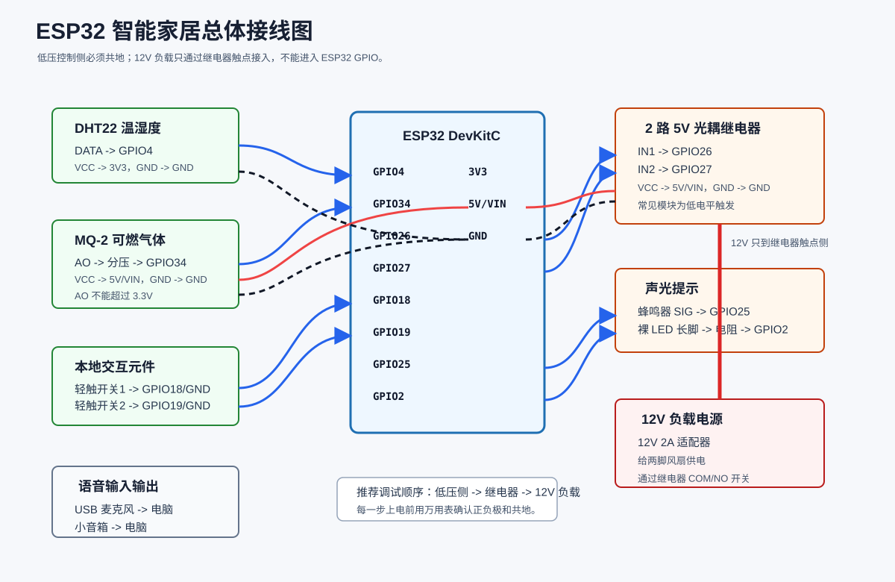
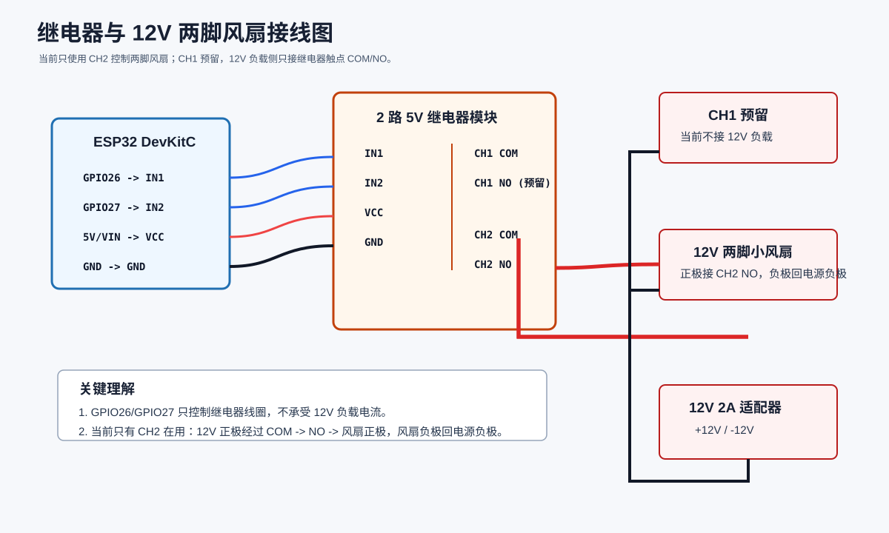
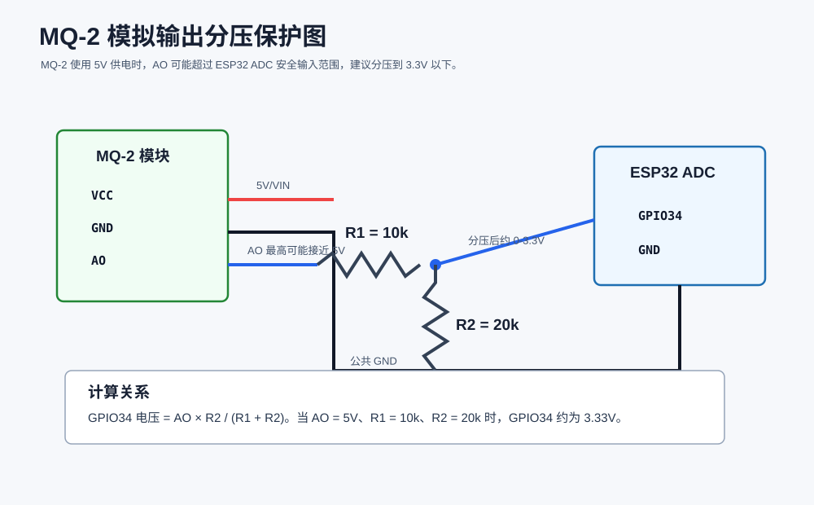
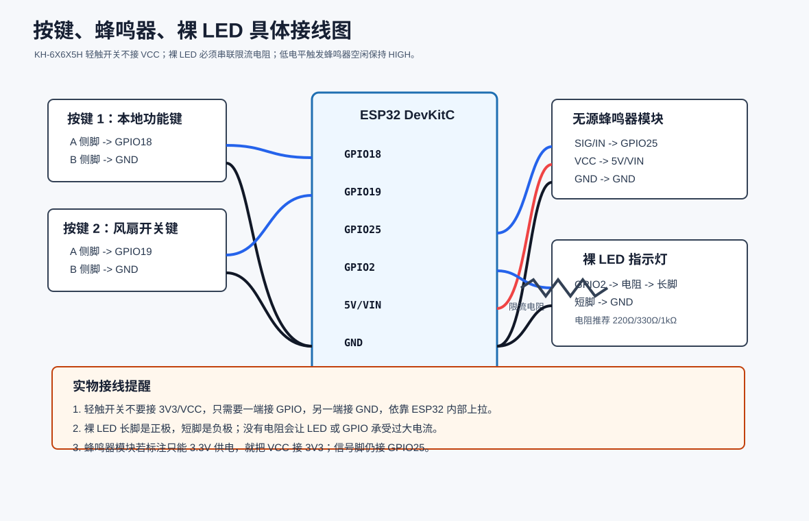

# 智能家居硬件图纸

这些图纸对应当前实物方案：

1. 一个 `ESP32 DevKitC`
2. 一个 `12V 两脚小风扇`
3. 一个普通裸 LED
4. 两个轻触开关
5. 一个无源蜂鸣器模块

## 1. 总体接线图

## 2. 继电器与 12V 风扇接线图

## 3. MQ-2 分压保护图

## 4. 按键、蜂鸣器、裸 LED 接线图

## 接线顺序

1. 先接低压侧：ESP32、DHT22、MQ-2、按键、蜂鸣器、裸 LED。
2. 再接继电器控制侧。
3. 最后断电接入 `12V 两脚小风扇`。

详细针脚表见：

[../PIN_CONNECTION_GUIDE.md](../PIN_CONNECTION_GUIDE.md)
